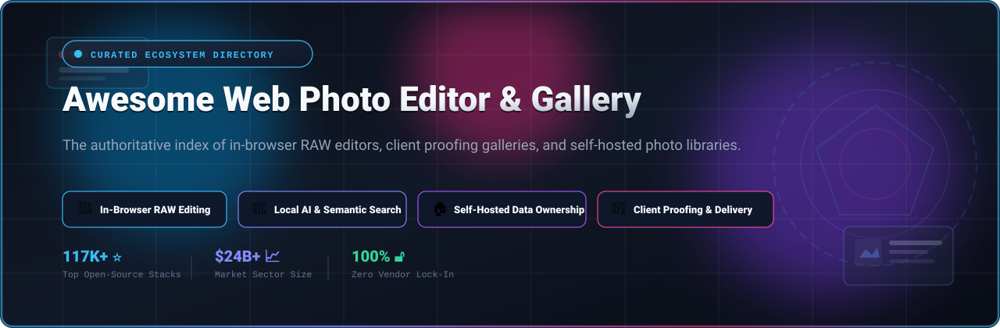

<p align="center">
  
</p>

<p align="center">
  <a href="https://github.com/ishandutta2007/Awesome-Awesome-Awesome"></a>
  <a href="https://discord.gg/jc4xtF58Ve"></a>
  <a href="https://github.com/ishandutta2007/Awesome-Web-Photo-Editor-Gallery/stargazers"></a>
  <a href="https://github.com/ishandutta2007/Awesome-Web-Photo-Editor-Gallery/network/members"></a>
  <a href="https://github.com/ishandutta2007/Awesome-Web-Photo-Editor-Gallery/blob/main/LICENSE"></a>
  <a href="https://github.com/ishandutta2007/Awesome-Web-Photo-Editor-Gallery/pulls"></a>
  <a href="https://github.com/ishandutta2007"></a>
</p>

---

# 📸 Awesome Web Photo Editor & Gallery

> 🌐 A curated index of top-tier **Web Photo Editors**, **Browser-Native RAW Processors**, **Photographer Client Delivery Galleries**, and **Self-Hosted AI Photo Management Stacks**.

Welcome to the definitive directory for web-based photography tools. Whether you are looking for zero-setup cloud **SaaS platforms** for client proofing or fully sovereign **open-source self-hosted solutions** to manage hundreds of thousands of camera originals without recurring subscription fees, this guide covers the entire modern photo stack.

---

## 📑 Table of Contents

- [📊 Sector Overview & Market Dynamics](#-sector-overview--market-dynamics)
- [🏢 SaaS & Hosted Platforms](#-saas--hosted-platforms)
- [💻 Open-Source GitHub Projects](#-open-source-github-projects)
- [🛠️ Architectural Recommendations](#️-architectural-recommendations)
- [🤝 How to Contribute](#-how-to-contribute)
- [💖 Support & Sponsorship](#-support--sponsorship)
- [📈 Star History](#-star-history)
- [⚖️ Disclaimer & License](#️-disclaimer--license)

---

## 📊 Sector Overview & Market Dynamics

* **Market Size & Trajectory:** The global digital photo editing and media asset/gallery management software market was valued at **$14.8 billion in 2025** and is projected to expand to **$24.5 billion by 2032** (growing at a CAGR of ~7.5%). This expansion is accelerated by the creator economy, high-resolution smartphone image sensors, browser-native WebAssembly (WASM) graphics engines, and demand for local on-device AI indexing.
* **Market Fragmentation & Competitive Landscape:** The sector exhibits a **moderately fragmented** dynamic. Traditional raster creative editing remains concentrated among dominant enterprise tech leaders (notably Adobe and Canva). Conversely, photographer client delivery, proofing workflows, and private photo storage are heavily fragmented across boutique SaaS providers (SmugMug, Pixieset, ShootProof) and a rapidly surging self-hosted open-source ecosystem (led by Immich and PhotoPrism) that disintermediates traditional per-seat cloud storage fees.

---

## 🏢 SaaS & Hosted Platforms

The table below catalogs premier commercial web photo editors and client gallery services, sorted by **company valuation and annual revenue (descending)**:

| 🏢 Platform | 💼 Company Size &amp; Valuation | 💰 Starting Tier Pricing | 🆓 Free Tier / Trial Limit | 🎯 Best For &amp; Key Capabilities |
| :--- | :--- | :--- | :--- | :--- |
| [**Adobe Lightroom Web**](https://lightroom.adobe.com/) | **~$215B Market Cap**<br>*(~$19.4B ARR)* | **$9.99/mo**<br>*(Lightroom Plan with 1TB cloud storage)* | **7-day free trial**<br>*(Full Creative Cloud features, 100 GB cloud storage, requires sign-up)* | Professional photographers seeking browser-accessible non-destructive RAW editing, color grading, and automatic desktop/mobile Creative Cloud sync. |
| [**Canva Photo Editor**](https://www.canva.com/photo-editor/) | **~$26B Valuation**<br>*(~$2.3B ARR)* | **$12.99/mo**<br>*(Canva Pro billed monthly, or $119.99/yr)* | **Free forever plan**<br>*(5 GB cloud storage, 1M+ free stock assets, basic image enhancement tools &amp; filters)* | Content creators and social media managers needing instantaneous web-based photo enhancements, background removal, templates, and collaborative galleries. |
| [**Cloudinary Media Gallery**](https://cloudinary.com/) | **~$1.2B Valuation**<br>*(~$150M+ ARR)* | **$89.00/mo**<br>*(Plus Plan billed monthly, or $990/yr)* | **Free forever plan**<br>*(25 monthly credits: up to 25,000 transformations or 25 GB net managed storage/bandwidth)* | Developers and digital agencies building programmatic web galleries, automated responsive image optimization, and dynamic on-the-fly transformations. |
| [**SmugMug**](https://www.smugmug.com/) | **~$100M+ Annual Revenue**<br>*(Private / Parent of Flickr)* | **$9.00/mo**<br>*(Basic Plan billed annually at $110/yr, or $13/mo monthly)* | **14-day free trial**<br>*(Unlimited full-resolution uploads, custom storefront builder, no credit card required)* | Professional photographers seeking custom portfolio websites, unlimited full-resolution image storage, and integrated turnkey print fulfillment. |
| [**Flickr**](https://www.flickr.com/) | **~$100M+ Parent Revenue**<br>*(60M+ community members)* | **$7.00/mo**<br>*(Flickr Pro billed annually at $84/yr, or $9.49/mo monthly)* | **Free forever plan**<br>*(Strictly capped at 1,000 photos/videos max, standard resolution, ad-supported)* | Hobbyist and fine-art photographers wanting social discovery, community critiques, photo groups, and public portfolio galleries. |
| [**Pixieset**](https://pixieset.com/) | **~$40M+ Annual Revenue**<br>*(PSG Equity backed)* | **$8.00/mo**<br>*(Starter Plan billed annually at $96/yr, or $10/mo monthly; 10 GB)* | **Free forever plan**<br>*(3 GB storage limit, unlimited client galleries, digital proofing, standard download controls)* | Wedding and portrait photographers requiring branded client proofing galleries, PIN-protected downloads, and seamless print lab delivery. |
| [**ShootProof**](https://www.shootproof.com/) | **~$20M+ Annual Revenue**<br>*(Serent Capital / Celero)* | **$10.00/mo**<br>*(1,500 Photos tier billed annually at $120/yr, or $12/mo monthly)* | **14-day free trial**<br>*(Up to 100 photo uploads, full access to contracts, invoices, and proofing galleries)* | Professional photography studios needing integrated business operations, digital contract signing, invoicing, and client photo sales. |
| [**Photopea**](https://www.photopea.com/) | **~$1.5M - $2M ARR**<br>*(Profitable Solopreneur)* | **$5.00/mo**<br>*(Single User Premium ad-free, or $15/quarter)* | **Free forever plan**<br>*(100% of editing features enabled, PSD/RAW/Vector support, 30 undo steps, ad-supported)* | Power users needing Photoshop-equivalent layer, mask, and filter editing directly in any web browser without installation. |

---

## 💻 Open-Source GitHub Projects

The following self-hosted galleries and browser-based photo editors are ranked strictly in **descending order of GitHub Star count**. Each badge connects directly to the repository's stargazers.

### 1. [Immich](https://github.com/immich-app/immich) [](https://github.com/immich-app/immich/stargazers)
* **License:** AGPL-3.0 | **Stack:** TypeScript, Dart, Python, Docker
* **Overview:** The premier self-hosted alternative to Google Photos. Features automatic background camera backup from iOS and Android devices, timeline navigation, shared partner libraries, and album management.
* **Key Strengths:** High-performance local machine learning pipeline — runs facial clustering, CLIP natural-language semantic query search ("sunset over mountains"), and reverse-geocoding without sending a single byte to third-party cloud APIs.
* **Considerations:** Machine learning indexing is CPU/GPU intensive (benefits from OpenVINO/CUDA hardware acceleration). Mobile upload creates a single repository copy; independent database and filesystem backups are essential.

### 2. [PhotoPrism](https://github.com/photoprism/photoprism) [](https://github.com/photoprism/photoprism/stargazers)
* **License:** AGPL-3.0 | **Stack:** Go, Vue.js, TensorFlow
* **Overview:** Highly mature, AI-powered self-hosted photo management system specifically engineered for browsing, indexing, and organizing extensive archival libraries of camera originals and RAW images.
* **Key Strengths:** World-class metadata extraction (Exif, XMP, IPTC), automatic face recognition, classification by color spectrum and location, and duplicate image detection across large storage pools.
* **Considerations:** Emphasizes web-first PWA browsing rather than native mobile background synchronization.

### 3. [Ente](https://github.com/ente-io/ente) [](https://github.com/ente-io/ente/stargazers)
* **License:** AGPL-3.0 | **Stack:** Flutter, Go, TypeScript
* **Overview:** End-to-end encrypted (E2EE) photo storage and client gallery platform designed for absolute data confidentiality. Cryptographic keys never leave the client device.
* **Key Strengths:** Seamless cross-platform client apps (iOS, Android, Web, Desktop), automated background sync, family sharing, and cryptographic guarantees that neither hosting providers nor server operators can view stored media.
* **Considerations:** Encrypted architecture precludes server-side AI processing; indexing occurs entirely client-side.

### 4. [Graphite](https://github.com/GraphiteEditor/Graphite) [](https://github.com/GraphiteEditor/Graphite/stargazers)
* **License:** Apache-2.0 | **Stack:** Rust, WebAssembly, TypeScript
* **Overview:** Next-generation 2D graphics and non-destructive raster/vector image editor that runs natively in modern web browsers powered by a high-performance procedural Rust engine.
* **Key Strengths:** Node-based non-destructive compositing, GPU-accelerated canvas, zero-install instant loading, and modern vector-plus-raster editing capabilities.
* **Considerations:** Rapidly evolving; some legacy desktop workflows and CMYK print pipelines are still in active development.

### 5. [LightCraft](https://github.com/storytold/lightcraft) [](https://github.com/storytold/lightcraft/stargazers)
* **License:** MIT / Apache-2.0 | **Stack:** Rust, WebAssembly, WebGPU
* **Overview:** An open-source, non-destructive photo editor and library manager built from scratch in pure Rust, offering a lightweight alternative to Adobe Lightroom.
* **Key Strengths:** Browser execution via WebAssembly alongside native desktop builds; native RAW decoding for Sony, Canon, Nikon, and Fujifilm sensors; non-destructive tone curves, exposure grading, and grain simulation.
* **Considerations:** Actively developing camera-specific color profiles and localized AI-masking features.

### 6. [LibrePhotos](https://github.com/LibrePhotos/librephotos) [](https://github.com/LibrePhotos/librephotos/stargazers)
* **License:** MIT | **Stack:** Python (Django), React
* **Overview:** Self-hosted photo management service (evolution of OwnPhotos) designed to give users a fully private personal Google Photos clone.
* **Key Strengths:** Face recognition and training, object and scene detection, semantic search, geocoding with map exploration, and Nextcloud filesystem integration.
* **Considerations:** Initial library scanning and face clustering requires moderate RAM and CPU resources during onboarding.

### 7. [TUI Image Editor](https://github.com/nhn/tui.image-editor) [](https://github.com/nhn/tui.image-editor/stargazers)
* **License:** MIT | **Stack:** JavaScript, HTML5 Canvas
* **Overview:** Battle-tested, full-featured web photo editor component easily embeddable into any web application or client gallery.
* **Key Strengths:** Intuitive crop, flip, rotate, drawing, shape masking, text overlay, and vintage filter processing. Lightweight with zero backend dependencies.
* **Considerations:** Primarily a front-end UI component for raster adjustments rather than a full catalog manager.

### 8. [Photoview](https://github.com/photoview/photoview) [](https://github.com/photoview/photoview/stargazers)
* **License:** AGPL-3.0 | **Stack:** Go, Vue.js, Docker
* **Overview:** Clean, user-friendly, self-hosted photo gallery designed for photographers who want a fast, lightweight presentation layer over an existing folder structure.
* **Key Strengths:** Low resource overhead, automatic thumbnail and video generation, RAW image format parsing, EXIF viewing, and face recognition.
* **Considerations:** Assumes directory-based library organization; does not modify underlying file structures.

### 9. [Lychee](https://github.com/LycheeOrg/Lychee) [](https://github.com/LycheeOrg/Lychee/stargazers)
* **License:** MIT | **Stack:** PHP (Laravel), TypeScript, Vue.js
* **Overview:** Elegant and minimalist self-hosted photo management system that runs effortlessly on standard LAMP/LEMP servers, NAS appliances, or Docker.
* **Key Strengths:** Fast upload workflow, password-protected albums, public sharing links, multi-user permissions, and responsive presentation.
* **Considerations:** Focused on clean presentation and basic organization; does not feature AI-assisted semantic tagging.

### 10. [Piwigo](https://github.com/Piwigo/Piwigo) [](https://github.com/Piwigo/Piwigo/stargazers)
* **License:** GPL-2.0 | **Stack:** PHP, MySQL
* **Overview:** Veteran open-source web photo gallery platform serving individuals, organizations, and professional photographers worldwide since 2002.
* **Key Strengths:** Extensive plugin and theme ecosystem (hundreds of extensions), batch management, fine-grained access permissions, and multi-language support.
* **Considerations:** Classic LAMP-stack architecture; modern single-page-app dynamics require specific community themes.

### 11. [Chevereto Free](https://github.com/rodber/chevereto-free) [](https://github.com/rodber/chevereto-free/stargazers)
* **License:** AGPL-3.0 | **Stack:** PHP, JavaScript
* **Overview:** Popular self-hosted image hosting software and multi-album gallery solution, functioning as a private Imgur/Flickr replacement.
* **Key Strengths:** Drag-and-drop web uploading, privacy controls, direct image link generation, embed codes for forums/markdown, and user profiles.
* **Considerations:** Advanced enterprise multi-server storage and commercial billing modules require paid Chevereto licenses.

### 12. [PiGallery 2](https://github.com/bpatrik/pigallery2) [](https://github.com/bpatrik/pigallery2/stargazers)
* **License:** MIT | **Stack:** TypeScript, Node.js, Angular
* **Overview:** Directory-first photo gallery website designed specifically for low-powered single-board computers (like the Raspberry Pi).
* **Key Strengths:** Blazing fast navigation directly mirroring folder hierarchies, zero lock-in, on-the-fly transcoding, and low RAM utilization.
* **Considerations:** Intended as a lean viewing and browsing gallery rather than an in-browser photo manipulation tool.

### 13. [Filerobot Image Editor](https://github.com/scaleflex/filerobot-image-editor) [](https://github.com/scaleflex/filerobot-image-editor/stargazers)
* **License:** MIT | **Stack:** React, TypeScript, HTML5 Canvas
* **Overview:** Responsive in-browser image editor widget designed for integration into CMSs, client upload portals, and digital asset management tools.
* **Key Strengths:** Fine adjustment controls (brightness, contrast, saturation, exposure), watermarking, preset filters, image annotations, and crop presets.
* **Considerations:** Front-end editor component requiring backend integration for file persistence.

### 14. [PicPeak](https://github.com/PicPeak/picpeak) [](https://github.com/PicPeak/picpeak/stargazers)
* **License:** MIT | **Stack:** TypeScript, Docker
* **Overview:** Tailored self-hosted client gallery and proofing platform built specifically for working event and wedding photographers looking to replace Pixieset or ShootProof.
* **Key Strengths:** Password-protected time-limited client galleries, free white-label branding, guest uploads, download tracking, webhook integrations (n8n/Slack/Zapier), and Lightroom Classic plugin sync for proofing selections.
* **Considerations:** Newer project compared to Immich; rapidly expanding its community and feature set.

### 15. [CalibRaw](https://github.com/Duecki1/CalibRaw) [](https://github.com/Duecki1/CalibRaw/stargazers)
* **License:** GPL-3.0 | **Stack:** C++, WebAssembly, Android
* **Overview:** Cross-platform RAW image editor for Android, Web, and Desktop featuring familiar Lightroom-style parameter sliders and local AI processing.
* **Key Strengths:** Tone curves, masks, color grading, HDR merging, and local on-device AI object removal without sending RAW captures to third-party cloud servers.
* **Considerations:** Community reports intermittent stability bugs during intensive batch operations; under active rapid iteration.

### 16. [GNU MediaGoblin](https://savannah.gnu.org/projects/mediagoblin/)
* **License:** AGPL-3.0 | **Stack:** Python
* **Overview:** Free software, decentralized media publishing platform designed to provide a federated alternative to Flickr, YouTube, and SoundCloud.
* **Key Strengths:** Multi-format support (photos, videos, 3D models), decentralization principles, and community-driven GNU stewardship.
* **Considerations:** Development pace is conservative; focused primarily on federated publishing.

---

## 🛠️ Architectural Recommendations

To construct a resilient, high-performance web photography stack without vendor lock-in, consider combining these specialized layers:

```
┌────────────────────────────────────────────────────────┐
│             Web Client / Presentation Layer            │
│      (PicPeak for Proofing  •  Photoview for Family)   │
└───────────────────────────▲────────────────────────────┘
                            │
┌───────────────────────────┴────────────────────────────┐
│          In-Browser Editing & Processing Layer         │
│     (LightCraft RAW Engine  •  Filerobot / TUI Canvas)  │
└───────────────────────────▲────────────────────────────┘
                            │
┌───────────────────────────┴────────────────────────────┐
│           AI Indexing & Catalog Management             │
│        (Immich Local Vision  •  PhotoPrism EXIF)       │
└───────────────────────────▲────────────────────────────┘
                            │
┌───────────────────────────┴────────────────────────────┐
│               Sovereign Storage & Backup               │
│        (ZFS/Btrfs NAS  •  Ente Cryptographic Sync)      │
└────────────────────────────────────────────────────────┘
```

1. **For Wedding & Event Photographers:** Deploy **[PicPeak](https://github.com/PicPeak/picpeak)** for client proofing galleries with watermarking and Lightroom rating sync, paired with **[LightCraft](https://github.com/storytold/lightcraft)** for rapid in-browser adjustments.
2. **For Families & Personal Archives:** Run **[Immich](https://github.com/immich-app/immich)** with hardware transcoding and local facial clustering for effortless mobile backup and semantic image retrieval.
3. **For Large Historical RAW Archives:** Deploy **[PhotoPrism](https://github.com/photoprism/photoprism)** over existing directory structures to gain comprehensive EXIF/metadata indexing and location mapping without reorganizing file trees.
4. **For Web Apps & Portals:** Embed **[Filerobot](https://github.com/scaleflex/filerobot-image-editor)** or **[TUI Image Editor](https://github.com/nhn/tui.image-editor)** to deliver responsive in-browser image adjustments without requiring backend compute.

---

## 🤝 How to Contribute

Contributions are warmly welcomed! To contribute:

1. 🍴 **Fork** the repository: [Awesome-Web-Photo-Editor-Gallery](https://github.com/ishandutta2007/Awesome-Web-Photo-Editor-Gallery).
2. 🌿 Create a feature branch: `git checkout -b feature/add-new-tool`.
3. 📝 Add or update entries in `README.md` maintaining the existing tabular/star-badge format and objective criteria.
4. 🔍 Ensure links are active and descriptions remain factual and vendor-neutral.
5. 🚀 Submit a **Pull Request** with a concise summary of the changes.

> 💡 Discover more curated developer indexes in [Awesome-Awesome-Awesome](https://github.com/ishandutta2007/Awesome-Awesome-Awesome).

---

## 💖 Support & Sponsorship

If this curated guide helped you discover your next photo editor, streamline client delivery, or reclaim control over your photo archive:

* ⭐ **Star** this repository to help other creators and engineers discover it.
* 🍴 **Fork** and share it with your photography and developer circles.
* ☕ **Sponsor & Buy a Coffee:** You can support continuous maintenance and curation by sponsoring via the [GitHub Sponsors Dashboard](https://github.com/sponsors/ishandutta2007). Your support is greatly appreciated!

---

## 📈 Star History

[](https://star-history.dera.page/#ishandutta2007/Awesome-Web-Photo-Editor-Gallery&type=date&legend=top-left)

---

## ⚖️ Disclaimer & License

* This is an open community-curated directory intended for educational and architectural evaluation. Product names, logos, and brands are property of their respective owners.
* Self-hosted solutions require proper data replication, automated database backups, and secure network configuration.
* Released under the [MIT License](LICENSE).